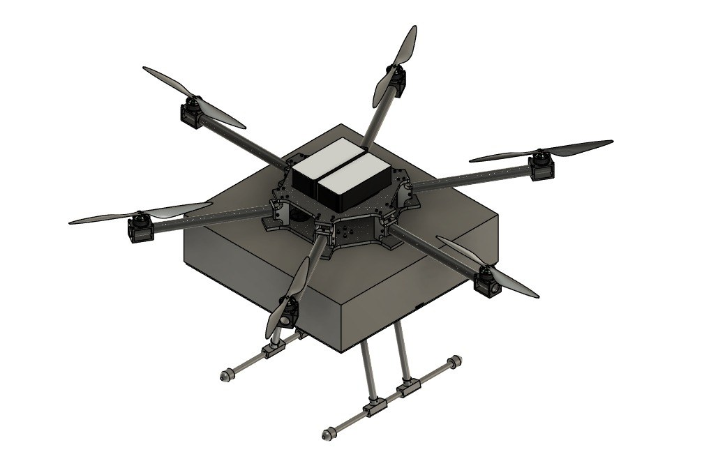
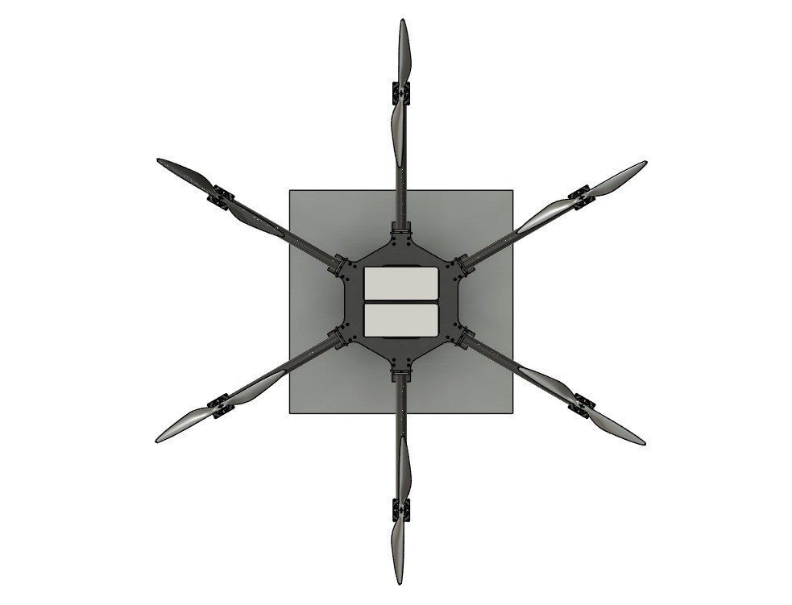
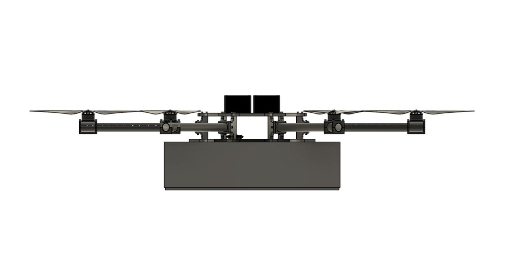
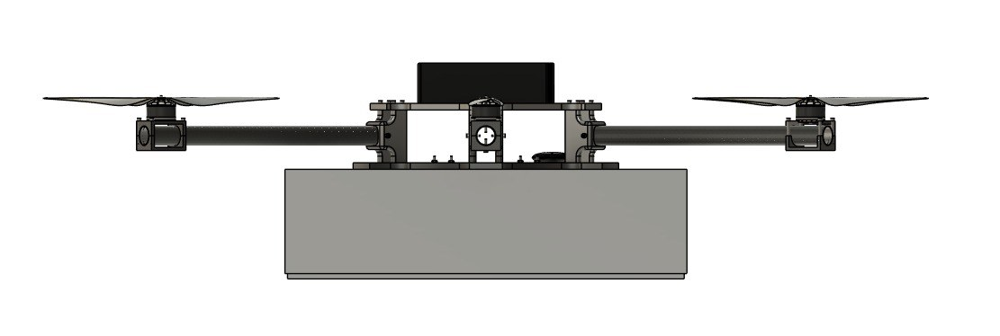
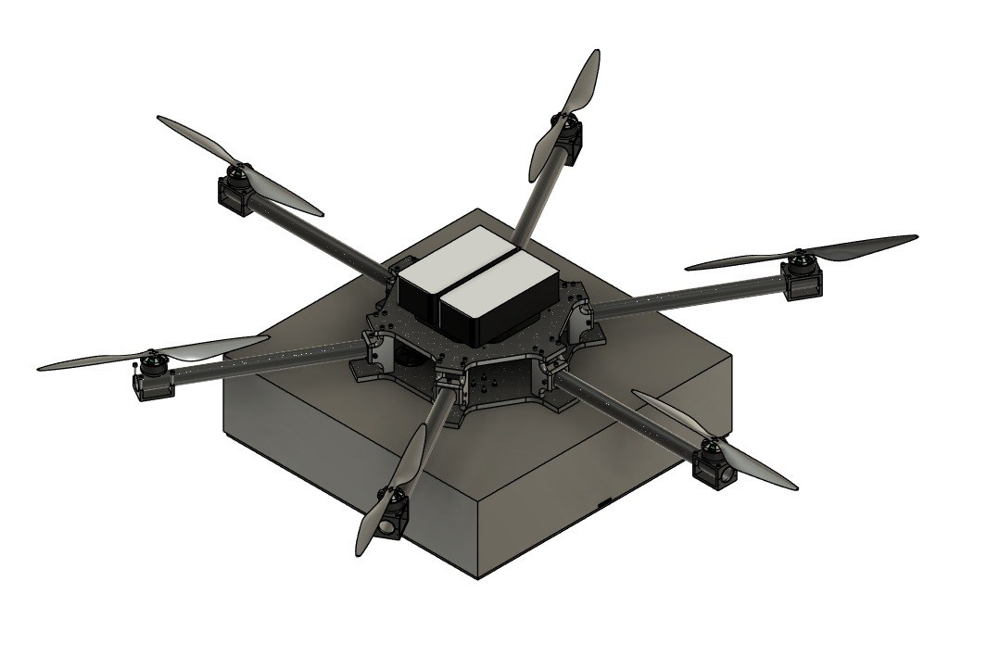
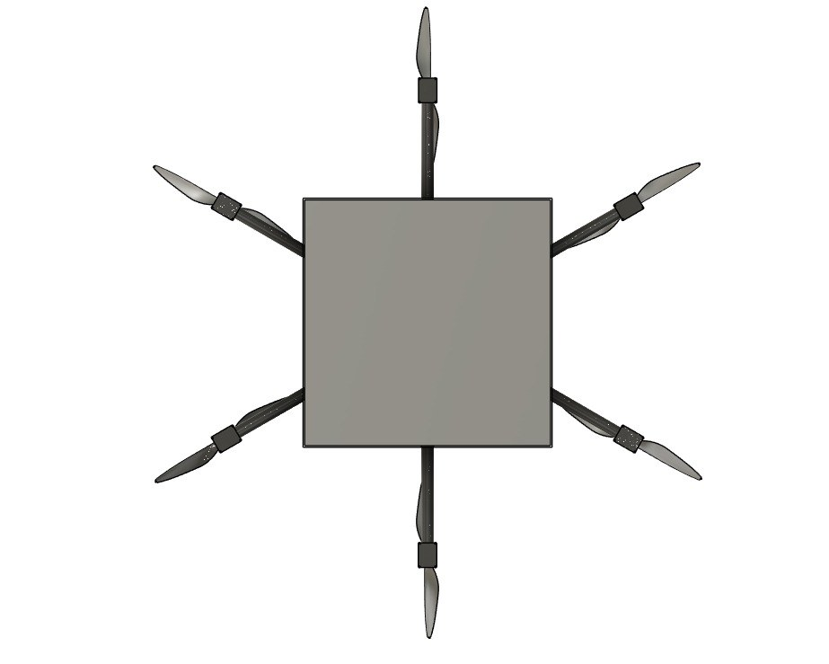
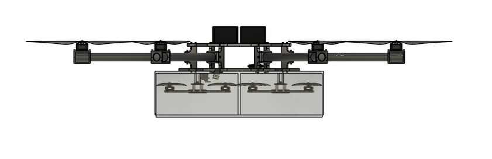
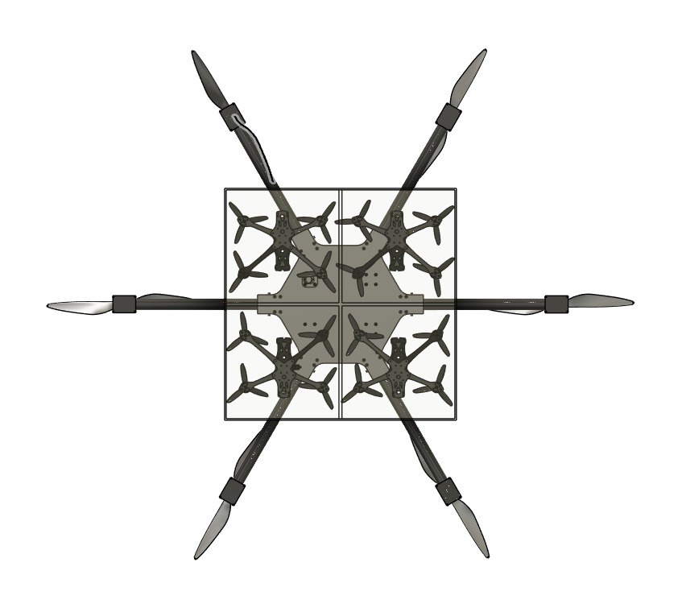
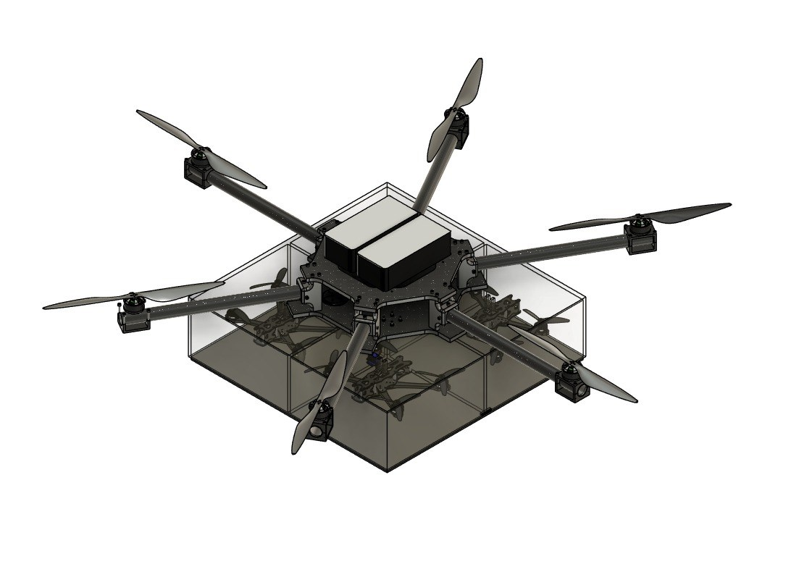

# Multi-Purpose Multi-Drone Carrier Concept

A carrier-drone concept planned to transport approximately **four smaller drones** using a **servo-operated deployment mechanism**. The project explored how the smaller vehicles could be accommodated within a larger multirotor platform.

## My contribution — Semester 7

I worked on the carrier design and electronics as part of the team. The project reached a CAD concept and partial prototype stage.

## Development status

Our team completed the CAD concept and started prototype work, reaching an estimated **20–30% completion**. Cost constrained further development, and the work did not reach a completed physical prototype.

The four-drone carrying arrangement and servo mechanism describe the planned system. Carrying flight and deployment of smaller drones have not been established as completed tests.

## Design approach

The concept combines a larger multirotor airframe with a central carrying structure. A servo mechanism was planned to operate the deployment arrangement. The CAD views below show the proposed layout from different angles.

| Item | Project details |
| --- | --- |
| Planned capacity | Approximately four small drones |
| Planned actuation | Servo mechanism |
| Completed work | CAD concept and partial prototype work |
| Estimated prototype progress | 20–30% |
| Main constraint | Cost |

## CAD concept views

